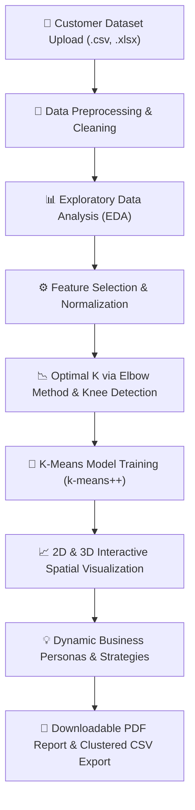

# Customer Segmentation System Using K-Means Clustering Algorithm

> *"Understand Your Customers. Discover Business Opportunities."*

[](https://www.python.org/)
[](https://fastapi.tiangolo.com/)
[](https://scikit-learn.org/)
[](https://react.dev/)
[](https://tailwindcss.com/)
[](https://plotly.com/)

An end-to-end, academic-grade Machine Learning and Business Intelligence web application designed for customer profiling, market segmentation, and targeted commercial strategy optimization. Developed as a **Major Academic Project in Computer Science & Engineering (Data Analytics & Machine Learning)**.

---

## 📑 Table of Contents
1. [Project Overview & Objectives](#project-overview--objectives)
2. [Problem Statement](#problem-statement)
3. [System Architecture & Workflow](#system-architecture--workflow)
4. [Mathematical Methodology of K-Means](#mathematical-methodology-of-k-means)
5. [Key System Features & Dashboard Tabs](#key-system-features--dashboard-tabs)
6. [Technology Stack](#technology-stack)
7. [Quick Start & Execution](#quick-start--execution)
8. [Directory Structure](#directory-structure)
9. [Limitations & Future Enhancements](#limitations--future-enhancements)

---

## 🎯 Project Overview & Objectives

In modern business environments, enterprises collect vast volumes of transactional and demographic data. However, raw data without structured segmentation leaves marketing teams executing broad, inefficient campaigns.

This project delivers a complete, production-ready system that:
1. **Groups customers** based on multidimensional feature similarities (Annual Income, Spending Score, Age, Order Frequency, Total Spend).
2. **Determines optimal cluster count ($K$)** scientifically using the **Elbow Method (WCSS)** and **Silhouette Coefficient Analysis**.
3. **Applies K-Means Clustering** with standard/min-max data normalization.
4. **Visualizes customer spaces** in interactive **2D and 3D WebGL projections** with centroid markers and radar profiles.
5. **Generates deep business intelligence personas**, evaluating financial capacity, retention risk, marketing strategies, and omnichannel communications.
6. **Produces executive analytical reports** downloadable as printable PDFs and clustered CSV datasets.

---

## 🔍 Problem Statement

Traditional customer segmentation relies on manual demographic thresholds or arbitrary rules of thumb. These static methods fail to reveal non-linear patterns across multiple behavioral attributes. Unsupervised machine learning, specifically **K-Means Clustering**, solves this by identifying natural clusters in multidimensional space without manual labeling.

---

## 🏗️ System Architecture & Workflow



---

## 📐 Mathematical Methodology of K-Means

### 1. Objective Function (WCSS / Inertia)
K-Means minimizes the Within-Cluster Sum of Squares (WCSS):
$$J = \sum_{j=1}^{K} \sum_{x_i \in C_j} ||x_i - \mu_j||^2$$
Where:
- $K$: Number of clusters
- $C_j$: Set of data instances belonging to cluster $j$
- $\mu_j$: Centroid coordinate of cluster $j$
- $||x_i - \mu_j||$: Euclidean distance between point $x_i$ and centroid $\mu_j$

### 2. Centroid Update Rule
During each expectation-maximization iteration, centroids are recomputed:
$$\mu_j = \frac{1}{|C_j|} \sum_{x_i \in C_j} x_i$$

### 3. Geometric Knee / Elbow Detection
To eliminate subjective guesswork in identifying the "elbow point", the system calculates the maximum perpendicular distance from the candidate point $(K_i, \text{WCSS}_i)$ to the line connecting $(K_1, \text{WCSS}_1)$ and $(K_{max}, \text{WCSS}_{max})$.

### 4. Silhouette Coefficient
$$s(i) = \frac{b(i) - a(i)}{\max(a(i), b(i))}$$
Where $a(i)$ is the mean intra-cluster distance, and $b(i)$ is the mean nearest-cluster distance.

---

## 🚀 Key System Features & Dashboard Tabs

1. **Dashboard Overview**: Executive KPIs (Total Customers, Clusters Identified, Average Income, Spending Score, Model Performance, Segment Distribution).
2. **Dataset Ingestion & Validation**: Drag-and-drop CSV/Excel loader with missing-value strategies (Drop, Mean, Median), schema validation, and live preview.
3. **Exploratory Data Analysis (EDA)**: Descriptive statistics table, histogram distributions, demographic pie charts, Pearson correlation heatmap, and bivariate scatter explorer.
4. **Customer Segmentation Module**: Dynamic feature checklist with recommendation tags, feature scalers (`StandardScaler`, `MinMaxScaler`), Elbow WCSS graph with marked knee point, Silhouette progression, and K-slider.
5. **Cluster Visualizations**:
   - 2D Scatter Plot with diamond centroid markers (◆).
   - 3D Interactive WebGL Spatial Model (360° pan, zoom, rotate).
   - Segment Size Distribution Pie Chart.
   - Multidimensional Centroid Radar Chart.
6. **Business Intelligence Engine**:
   - Generates contextual customer personas:
     - *VIP / Affluent Spenders* (High Income, High Spending)
     - *Aspirational / Trend-Driven Shoppers* (Low Income, High Spending)
     - *Cautious Savers / Untapped Potential* (High Income, Low Spending)
     - *Budget-Conscious / Value Seekers* (Low Income, Low Spending)
     - *Core / Mainstream Balancers* (Moderate cohort)
   - Evaluates retention risk, growth opportunities, and tailored marketing action items.
7. **Customer Records Explorer**: Searchable, sortable, paginated table with cluster badges and direct CSV download.
8. **Reports & Exports**: Publication-ready HTML report with native printable CSS layout (`window.print()` / PDF export) and academic methodology documentation.

---

## 💻 Technology Stack

| Layer | Technologies |
|---|---|
| **Programming Language** | Python 3.11+ |
| **Machine Learning** | Scikit-Learn (KMeans, StandardScaler, PCA, Metrics) |
| **Data Processing** | Pandas, NumPy, OpenPyXL |
| **Backend REST API** | FastAPI, Uvicorn, Python-Multipart, Pydantic |
| **Frontend UI** | React 18, Tailwind CSS, Lucide Icons, Vite |
| **Visualizations** | Plotly.js (2D & 3D WebGL charts, Heatmaps, Radars) |

---

## ⚡ Quick Start & Execution

### Prerequisites
- Python 3.11+
- Node.js 18+ (already bundled/pre-compiled in `frontend/dist`)

### Option A: 1-Click Launch (Windows)
Double-click `run.bat` or execute in PowerShell:
```powershell
.\run.ps1
```
Open **`http://localhost:8000`** in your browser.

### Option B: Python Virtual Environment Launch
```powershell
# Activate environment and start server
.\.venv\Scripts\Activate.ps1
cd backend
python -m uvicorn main:app --host 0.0.0.0 --port 8000
```
Visit `http://localhost:8000`.

### Option C: Developer Mode (Hot-Reloading Frontend)
- **Terminal 1 (Backend)**: `cd backend && ..\.venv\Scripts\python -m uvicorn main:app --reload --port 8000`
- **Terminal 2 (Frontend)**: `cd frontend && npm run dev`
Visit `http://localhost:3000`.

---

## 📁 Directory Structure

```text
Customer Segmentationn/
├── backend/
│   ├── sample_data/
│   │   ├── Mall_Customers.csv             # Benchmark dataset 1 (200 records)
│   │   └── Ecommerce_Customer_Data.csv    # Benchmark dataset 2 (100 records)
│   ├── main.py                            # FastAPI application & static server
│   ├── data_processor.py                  # Cleaning, metadata, distributions, EDA
│   ├── clustering.py                      # K-Means, Elbow method, 2D/3D projections
│   ├── insights_engine.py                 # Persona generation & marketing tactics
│   └── report_generator.py                # Executive HTML & print report builder
├── frontend/
│   ├── dist/                              # Pre-compiled high-performance production build
│   ├── src/
│   │   ├── components/                    # 8 modular dashboard views
│   │   ├── api.js                         # REST API client
│   │   ├── App.jsx                        # Primary layout & state management
│   │   └── index.css                      # Tailwind styling & typography
│   ├── package.json
│   └── vite.config.js
├── run.bat                                # 1-click Windows launcher
├── run.ps1                                # 1-click PowerShell launcher
└── README.md                              # Comprehensive documentation
```

---

## ⚠️ Limitations & Future Enhancements

### Limitations
- **Outlier Sensitivity**: Arithmetic mean centroids can be displaced by severe outliers.
- **Spherical Cluster Assumption**: K-Means assumes isotropic, convex clusters; elongated manifolds may require density-based clustering.
- **Hyperparameter Dependency**: The quality of segmentation depends on selecting a suitable $K$ value and proper feature scaling.

### Future Work
- Integration with **DBSCAN** and **Agglomerative Hierarchical Clustering**.
- Streaming real-time segmentation via **Mini-Batch K-Means** and Kafka.
- Native bi-directional CRM integration (Salesforce / HubSpot).
- AI Next-Best-Action recommendation engine based on customer segment propensity scores.

## live website 
 live link - https://vercel.com/simran-s-projects80/customer-segmentation
